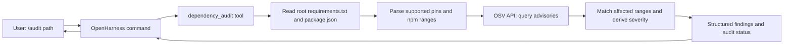

# OpenHarness plugin to do dependency auditing 

## Problem statement

Dependency manifests can declare vulnerable versions or ranges, but checking them manually against advisories is time-consuming and easy to miss. This plugin adds a read-only `/audit` command that checks Python `requirements.txt` and Node.js `package.json` declarations against OSV.dev, then returns structured findings for the OpenHarness agent to report. It does not install packages or change project files. `/audit summary` retrieves the latest audit from the current session.

## Architecture

The plugin is registered as `dependency_audit`; its Markdown command exposes `/audit`, and its Python tool parses manifests and queries OSV. A small OpenHarness patch lets the command use the bare name `/audit`.



Exact versions are queried directly. Supported npm ranges (`^`, `~`, partial/wildcard versions, and basic `>=`/`<` comparator ranges) are queried without a version, then compared locally with OSV affected-version data. For range findings, the reported lowest matching affected version is a candidate, not a claim about the installed version. Unsupported requirement forms are skipped and make the audit incomplete. Severity uses recognized OSV `database_specific.severity` first (`MODERATE` maps to `MEDIUM`), then derives a bucket from a complete CVSS v3.0/v3.1 base vector. Missing or invalid severity is `UNKNOWN`; supplied CVSS data is retained.

**DEMO** [Watch the short screen recording](https://youtu.be/Zn9166VxcLo) (unlisted) 

## Design decisions

- **Read-only, bounded input:** Read only the two supported files directly inside the selected folder; never install packages, execute project code, or edit files. Manifest size, package count, advisory count, response size, and request time are bounded.
- **Conservative parsing:** Support exact Python pins and a documented subset of npm ranges. Skip unsupported forms and report an incomplete audit rather than implying that skipped dependencies are safe.
- **Path and network boundaries:** Resolve manifest paths and enforce OpenHarness permission and active sandbox rules. Send HTTPS requests only to the fixed OSV API host, without following redirects or using environment proxy settings.
- **Honest range findings:** Compare supported npm ranges with advisory affected ranges locally. Since the declared range does not identify the selected/installed version, label the matching version as a candidate.
- **Severity provenance:** Prefer OSV's recognized database severity; use a complete CVSS v3 base vector only as a fallback, and preserve source CVSS data so the bucket has context.

Two AI LLMs were used for development and testing, run locally with llama.cpp ~ <br/> $\color{#00ff00}\textsf{Qwen2.5-7B-Q4KM}$ and $\color{#00ff00}\textsf{Qwen3.5-4B-Q4KM}$

## Key results 

This dependency audit workflow was executed against 2 public open source repos, <br/> [three.js](https://github.com/mrdoob/three.js/) for Nodejs package.json and [vulnerable-test-app](https://github.com/LauraWangQiu/vulnerable-test-app) for requirements.txt 

**`three.js`** (1 vulnerable package, `rollup@4.6.0`, 2 HIGH advisories)

| | Qwen2.5-7B | Qwen3.5 |
|---|---|---|
| Facts correct | Yes (same two GHSA IDs, HIGH) | Yes |
| Detail preserved | IDs and CVEs only; dropped version, titles, CVSS vectors and summaries | Status, source, timestamp, manifests, counts, errors, titles, aliases, CVSS 3.1/4.0 vectors, summaries |
| Advice | Generic "update to a non-vulnerable version" | Report only |

**`vulnerable-test-app`** (33 scanned, 23 vulnerable)

| | Qwen2.5-7B | Qwen3.5 |
|---|---|---|
| Counts reported | Neither 33 nor 23 | Both, in a table |
| Findings named | Flask 1.0.0, Jinja2 2.10 (vague "LOW to HIGH" range) | Same, plus CVE for Jinja2, grouped by manifest |
| Follow-up ("more info") | Repeated the same two names without calling the tool again | Pointed to the saved full-output artifact |

The interesting to note is that even though Qwen3.5-4B is a smaller model than Qwen2.5-7B, as a newer and more sophisticated model it was able to produce more comprehensive and useful information. Due to hardware limitations, larger models were not used in this testing. 

## Limitations and next steps

- Discovery is limited to root-level `requirements.txt` and `package.json`; for eg many newer repos use pyproject.toml instead, but this was not added due to time constraints. Python requirements must be exact pins, and npm range support is intentionally partial.
- The plugin does not read lockfiles, resolve dependency trees, inspect installed versions, or audit transitive dependencies. Adding lockfile support would improve version accuracy and coverage.
- The OSV batch query is not paginated. If a response provides a pagination token, later pages are not fetched. OSV availability and advisory coverage also affect results.
- Package names and exact pinned versions are sent to OSV; range-based npm queries send package names without versions. Consider the privacy implications before auditing proprietary package names.
- CVSS fallback covers complete v3.0/v3.1 base vectors; it is not a general severity or project-specific exploitability assessment. Broader CVSS versions and improved contextual severity remain possible follow-up work.
- `/audit summary` lasts only for the current in-memory session. Persisting reports could support later review, with appropriate retention controls.
- On Windows platforms, it might try to run commands using Bash first, throw errors that do not impact the objectives, then try PowerShell. The patch included in this plugin does not fix this as this feature (defaulting to PowerShell on Windows) would really be better off implemented by the upstream devs instead. 

Next steps for security auditing and pentesting detailed [HERE](https://github.com/SkinnyRat/OhPlugin/blob/main/SECURITY.md). 

## Use with upstream OpenHarness

The current upstream plugin loader prefixes plugin commands. This project includes a small OpenHarness patch that allows an individual Markdown plugin command to opt into a bare command name. The patch is pinned to upstream commit `9b2efd795c6aa09f88b0c257d269a9e518da6ae7`. If the local copy of OpenHarness already has a lot of custom changes, it might be necessary to clone a fresh copy from the upstream repo. 

For a Windows checkout, run `setup.ps1` from this plugin repository. It prompts for the OpenHarness checkout, checks and applies the patch (or detects that it is already applied), copies the plugin into that checkout's `.openharness/plugins`, and enables project plugins plus `dependency_audit` in the user's `~/.openharness/settings.json`. If a plugin copy already exists, the script asks before replacing it. Git changes are not reverted by the setup script.

```powershell
Set-ExecutionPolicy -Scope Process Bypass
.\setup.ps1
```

On Linux, run the Bash version from this plugin repository. It requires `git` and `python3`:

```bash
bash setup.sh
```

Both scripts preserve unrelated settings. The Linux script also honors `OPENHARNESS_CONFIG_DIR` when set, matching OpenHarness's config path behavior.

Then start `oh` ( or `uv run oh` ) from the project directory. The command is registered in the OpenHarness command picker and can be invoked as:

```text
/audit .
/audit path\to\project
/audit summary
```

The command submits a focused prompt to the running agent, which calls the plugin tool through OpenHarness's normal tool execution and permission checks. Relative paths stay under the current project directory; absolute paths may target another folder. Resolved manifest files are checked against OpenHarness path rules and any active Docker sandbox boundary, including symlink resolution. The audit makes HTTPS calls only to the fixed OSV API host, with bounded timeouts, response sizes, and package/advisory counts.

## Running tests

Run the unit tests and the OpenHarness CLI integration test from the plugin repository root. The Python environment needs `pytest`, `pytest-asyncio`, and the OpenHarness dependencies. The integration test runs `uv run oh --dry-run` from the OpenHarness checkout; set `OPENHARNESS_REPO` if that checkout is not at `../OpenHarness` relative to this repository.

The integration test does not invoke a model. Its successful run prints a green check. 

```powershell
python -m pytest tests/unit tests/integration
```

To run the interactive end-to-end check separately with a local llm running (OpenAI API compatible), use:

```powershell
python tests/e2e/run_manual_audit_e2e.py
```

The E2E script prompts for the OhPlugin folder path and runs `uv run oh -p "/audit <path>"` from the OpenHarness checkout. It uses the configured OpenHarness model and may make a live model request. It passes when the CLI output contains the expected message that no supported manifest was found; successful completion prints a green check. Set `OPENHARNESS_REPO` before running it if the checkout is elsewhere.

## OpenHarness patch contents

The patch adds the `openharness-command` Markdown frontmatter field, protects built-in command names from plugin replacement, and gives tools access to mutable session state for the summary feature. It includes focused tests for command registration and collision behavior.

## AI usage 

ChatGPT's codex tool was used for coding assistance, while Claude was used for tasks like markdown formatting. 
